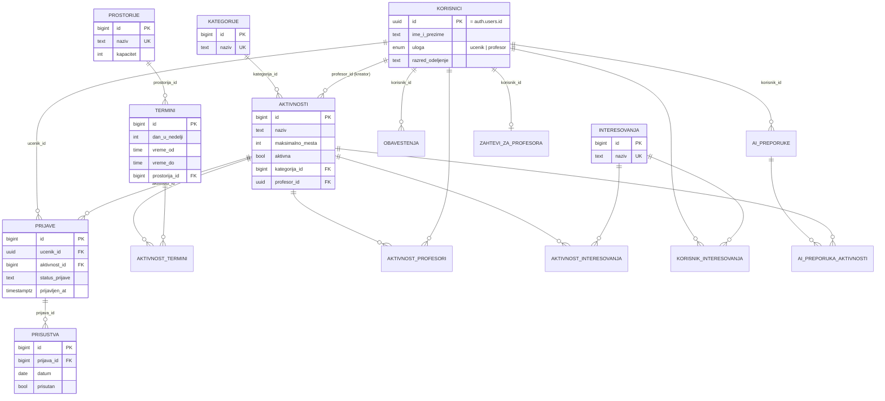

# Vodič za odbranu backend-a

Ovaj dokument prati zahteve za odbranu redom i za svaki pokazuje **gde je u kodu** i **kako radi**.

---

## 1. Zašto ove tehnologije

| Izbor | Razlog |
|---|---|
| **Node.js + Express 5** | Isti jezik (JavaScript) kao React Native, pa frontend i backend dele znanje i JSON format. Express je minimalan i lako se objašnjava: ruta → middleware → kontroler. Express 5 automatski hvata greške iz `async` funkcija i šalje ih error handleru. |
| **Supabase (PostgreSQL)** | Prava relaciona baza sa primarnim i stranim ključevima, plus gotova autentifikacija (Supabase Auth, JWT). Klijent `@supabase/supabase-js` pravi SQL upite preko REST-a. |
| **REST + JSON** | React Native aplikacija ga poziva običnim `fetch` pozivom. |

---

## 2. Arhitektura – slojevi i njihove odgovornosti

```
HTTP zahtev (Postman / React Native)
        │
        ▼
 server.js ── app.js ── cors ── express.json()          ← 1. server i konfiguracija
        │
        ▼
 routes/*.js            URL + metoda (GET/POST/PUT/PATCH/DELETE)   ← 2. rute
        │
        ▼
 middleware/zahtevajPrijavu   ko si? (token)            ← 5/8. autentifikacija
 middleware/zahtevajUlogu     smeš li? (uloga)          ← 5/8. autorizacija
 middleware/validiraj         da li su podaci ispravni? ← 9. validacija
        │
        ▼
 controllers/*.js       uzima req.podaci, poziva servis, vraća status + JSON  ← 3.
        │
        ▼
 services/*.js          poslovna pravila + upiti ka bazi                      ← 4.
        │
        ▼
 config/supabase.js ──► Supabase (PostgreSQL)                                 ← 6.
        │
   greška bilo gde ──► middleware/errorHandler.js ──► { "greska": "..." }      ← 10.
```

**Pravilo razdvajanja:** kontroler ne zna ništa o bazi, servis ne zna ništa o HTTP-u (nema `req`/`res`).
Servis signalizira grešku sa `throw greska(409, "Nema slobodnih mesta.")`, a errorHandler od toga pravi HTTP odgovor.

### Mapa zahteva → fajlovi

| # | Zahtev | Gde |
|---|---|---|
| 1 | Server i konfiguracija | `src/server.js` (pokretanje), `src/app.js` (middleware, rute), `src/config/cors.js`, `src/config/swagger.js` |
| 2 | API rute | `src/routes/index.js` + `src/routes/*Routes.js` |
| 3 | Kontroleri | `src/controllers/*.js` |
| 4 | Servisi | `src/services/*.js` |
| 5 | Middleware | `src/middleware/` – `zahtevajPrijavu`, `zahtevajUlogu`, `validiraj`, `nepostojecaRuta`, `errorHandler` |
| 6 | Supabase konfiguracija | `src/config/supabase.js`, `.env` (nije u git-u), `.env.example` |
| 7 | CRUD | svaki modul; npr. prostorije: `POST/GET/PATCH/DELETE /api/prostorije` |
| 8 | Auth | `src/services/authService.js`, `src/routes/authRoutes.js`, middleware iznad |
| 9 | Validacija | `src/validators/*.js` + `src/middleware/validiraj.js` |
| 10 | Obrada grešaka | `src/middleware/errorHandler.js`, `src/utils/http.js` (`HttpGreska`) |
| 11 | Testiranje | `postman/` (88 zahteva sa testovima), `test/` (`npm test`) |
| 12 | Organizacija | struktura iznad; jedan modul = ruta + validator + kontroler + servis |

---

## 3. Tok jednog zahteva od početka do kraja

Primer: **učenik se prijavljuje na aktivnost 12**

```
POST /api/aktivnosti/12/prijava
Authorization: Bearer eyJhbGciOi...
```

1. **`app.js`** – `cors` proverava domen, `express.json()` parsira telo. `app.use("/api", apiRute)`
   prosleđuje zahtev u `routes/index.js`, koji ga šalje u `aktivnostRoutes` (prefiks `/aktivnosti`).
2. **`routes/aktivnostRoutes.js`** – ruta
   `router.post("/:aktivnostId/prijava", zahtevajPrijavu, zahtevajUlogu("ucenik"), validiraj(vp.ucenikovaPrijava), prijave.prijava)`.
3. **`zahtevajPrijavu`** – izvlači token iz zaglavlja i proverava ga sa `authSupabase.auth.getUser(token)`.
   Zatim učitava profil iz tabele `korisnici` i postavlja `req.korisnik` i `req.profil`.
   Ako tokena nema, poziva `next(greska(401, ...))`.
4. **`zahtevajUlogu("ucenik")`** – ako `req.profil.uloga` nije `ucenik`, vraća 403.
5. **`validiraj(...)`** – proverava da je `:aktivnostId` pozitivan ceo broj i upisuje `req.podaci = { aktivnostId: 12 }`.
   Za `abc` vraća 400 i kontroler se ne poziva.
6. **`controllers/prijavaController.prijava`** – poziva
   `prijavaService.prijaviSe(req.korisnik.id, req.podaci.aktivnostId)`. ID učenika uzima **iz tokena**, nikada iz tela zahteva.
7. **`services/prijavaService.prijaviSe`**:
   - učitava aktivnost (404 ako ne postoji ili nije aktivna);
   - proverava preklapanje sa rasporedom učenika (409);
   - poziva SQL funkciju `bezbedna_prijava` (RPC), koja **u jednoj transakciji** zaključava aktivnost
     i proverava duplikat i slobodna mesta;
   - pravi obaveštenje u tabeli `obavestenja`.
8. Kontroler vraća **`201 Created`** i `{ "poruka": "Uspešno ste se prijavili.", "prijava": {...} }`.
9. Ako bilo koji korak baci grešku, Express je prosleđuje u **`errorHandler`**, koji vraća npr.
   `409 { "greska": "Nema slobodnih mesta na ovoj aktivnosti." }`.

---

## 4. Komunikacija sa Supabase bazom

`src/config/supabase.js` pravi dva klijenta iz `.env` promenljivih:

| Klijent | Ključ | Koristi se za |
|---|---|---|
| `authSupabase` | `SUPABASE_ANON_KEY` (javni) | registracija, prijava, provera tokena |
| `dbSupabase` | `SUPABASE_SERVICE_ROLE_KEY` (tajni) | svi upiti nad tabelama, sa serverske strane |

Supabase klijent ne baca izuzetke, nego uvek vraća `{ data, error }`:

```js
const { data, error } = await dbSupabase
  .from("prostorije")          // FROM prostorije
  .select("id, naziv")         // SELECT id, naziv
  .eq("id", 3)                 // WHERE id = 3
  .maybeSingle();              // jedan red ili null
if (error) throw error;        // → errorHandler
```

CRUD → SQL: `.insert()` = INSERT, `.select()` = SELECT, `.update().eq()` = UPDATE … WHERE,
`.delete().eq()` = DELETE … WHERE, `.rpc("ime")` = poziv PostgreSQL funkcije.

**Bezbednost:** sve tabele imaju uključen Row Level Security bez politika. Zato javni ključ ne može
direktno da čita podatke, a pristup ide isključivo preko backend-a, koji proverava token i ulogu.
Tajni ključ je samo u `.env`, a `.env` je u `.gitignore`.

---

## 5. Baza podataka: entiteti i relacije

Kompletan SQL: `supabase/schema.sql`.



**Ključne relacije:**
- **Korisnik – Aktivnost** je veza **N:N** preko entiteta **Prijava**. Prijava ima sopstvene atribute
  (`status_prijave`, `prijavljen_at`), pa je zaseban entitet, a ne samo povezna tabela.
- **Prijava 1:N Prisustvo**: jedan zapis po datumu (`UNIQUE (prijava_id, datum)`).
- **Aktivnost N:N Termin**, **Aktivnost N:N Interesovanje**, **Korisnik N:N Interesovanje**:
  čiste povezne tabele sa složenim primarnim ključem `(a_id, b_id)`.
- **Prostorija 1:N Termin**: `EXCLUDE` ograničenje u bazi zabranjuje termine koji se preklapaju u istoj prostoriji.
- **korisnici.id = auth.users.id** (1:1): Supabase Auth čuva email i lozinku, a naša tabela čuva profil i ulogu.

`ON DELETE RESTRICT` sprečava brisanje roditelja koji ima decu (npr. prostorije sa terminima).
`CASCADE` briše decu zajedno sa roditeljem (npr. obaveštenja korisnika).

---

## 6. Autentifikacija i autorizacija

| Radnja | Endpoint | Šta se dešava |
|---|---|---|
| Registracija | `POST /api/auth/registracija` | `supabase.auth.signUp` pravi nalog, a backend upisuje red u `korisnici` sa ulogom **ucenik**. Ako je tražen profesorski nalog, pravi se zahtev na čekanju. |
| Prijava | `POST /api/auth/prijava` | `signInWithPassword` vraća **access token** (JWT, kratkog trajanja) i **refresh token**. |
| Provera tokena | svaka zaštićena ruta | `zahtevajPrijavu` → `auth.getUser(token)` proverava potpis i rok važenja. |
| Osvežavanje | `POST /api/auth/osvezi-token` | novi access token na osnovu refresh tokena |
| Odjava | `POST /api/auth/odjava` | `auth.admin.signOut(token, "global")` poništava sesije |
| Autorizacija | `zahtevajUlogu("profesor")` | 403 ako uloga ne odgovara |
| Kontrola pristupa podacima | servisi | upiti filtriraju po `req.korisnik.id`, pa učenik vidi samo **svoje** prijave, obaveštenja i preporuke |

Uloga se nikada ne uzima iz tela zahteva. Čita se iz baze na osnovu tokena, pa korisnik ne može sam sebi da dodeli ulogu profesora.

---

## 7. Validacija

Svaki modul ima validator u `src/validators/`. Validator je funkcija `(req) => podaci`:

```js
// validators/prostorijaValidator.js
function kreiranje(req) {
  const b = v.telo(req);
  if (!v.jeNeprazanTekst(b.naziv, 100)) throw v.greska(400, "Neispravni podaci o prostoriji.");
  return { unos: { naziv: b.naziv.trim(), kapacitet: kapacitet(b.kapacitet, "..."), ... } };
}

// routes/prostorijaRoutes.js
router.post("/", profesor, validiraj(v.kreiranje), kontroler.kreiranje);
```

Proverava se sledeće:
- obavezna polja;
- tipovi (`Number.isInteger`, `typeof === "boolean"`, UUID);
- format (email, datum `YYYY-MM-DD`, vreme `HH:MM`, URL);
- opseg (dan 1–7, kapacitet > 0, dužina teksta);
- dozvoljene vrednosti (`status_prijave` ∈ `prijavljen | na_cekanju | otkazano`).

Validator vraća **očišćene** podatke: trim-ovan tekst, brojeve umesto stringova i samo dozvoljena polja.
Polje koje klijent pošalje, a koje nije predviđeno (npr. `profesor_id`), ignoriše se.

Validacija postoji na tri nivoa: **validator** (format), **servis** (poslovna pravila: postoji li
kategorija, ima li mesta) i **baza** (`NOT NULL`, `CHECK`, `UNIQUE`, `FOREIGN KEY`).

---

## 8. Obrada grešaka

`src/middleware/errorHandler.js` je middleware sa 4 parametra `(err, req, res, next)`. Express 5
automatski hvata greške iz `async` kontrolera, pa kontroleri nemaju `try/catch`.

| Izvor greške | Rezultat |
|---|---|
| `throw greska(404, "Aktivnost nije pronađena.")` | 404 + ta poruka |
| neispravan JSON u telu | 400 "Telo zahteva nije ispravan JSON." |
| PostgreSQL `23505` (UNIQUE) | 409 "Takav zapis već postoji." |
| PostgreSQL `23503` (FOREIGN KEY) | 409 |
| PostgreSQL `22P02` (pogrešan tip) | 400 |
| tabela ne postoji (`42P01`) | 503 + uputstvo za migraciju |
| sve ostalo | 500 "Došlo je do greške na serveru." (detalji samo u logu servera) |

Nepostojeća ruta → `nepostojecaRuta.js` → 404 JSON.

---

## 9. Povezivanje sa React Native aplikacijom

Backend je spreman: vraća JSON, koristi standardne HTTP metode i Bearer token, a CORS dozvoljava Expo web.

```js
// U React Native aplikaciji (Expo). Telefon i računar moraju biti u istoj WiFi mreži;
// "localhost" na telefonu je sam telefon, zato se koristi IP adresa računara (ipconfig).
const API = "http://192.168.1.10:3000/api";

// Prijava
const odgovor = await fetch(`${API}/auth/prijava`, {
  method: "POST",
  headers: { "Content-Type": "application/json" },
  body: JSON.stringify({ email, lozinka })
});
const podaci = await odgovor.json();
if (!odgovor.ok) throw new Error(podaci.greska);
const token = podaci.token; // čuvati npr. u expo-secure-store

// Zaštićen zahtev
const aktivnosti = await fetch(`${API}/aktivnosti`, {
  headers: { Authorization: `Bearer ${token}` }
}).then(r => r.json());
```

U komponenti bi se ovo pozivalo iz `useEffect`, a rezultat bi se čuvao u `useState` i prikazivao u `FlatList`.
Mobilna aplikacija nikada ne dobija `SERVICE_ROLE` ključ: ona zna samo URL backend-a i svoj token.

---

## 10. Testiranje

- **Postman** (`postman/`): 88 zahteva koji redom pokrivaju prijavu, CRUD nad svim entitetima,
  prijave, prisustvo, profil, obaveštenja, AI i admin panel. Uključeni su i negativni slučajevi
  (400/401/403/404/409), a na kraju je čišćenje. Tokeni i ID-jevi se automatski prenose između zahteva.
  Posle izvršavanja promene se vide u Supabase → Table Editor.
- **Automatski testovi** (`npm test`): validatori, middleware (401/403/404/400), error handler,
  autentifikacija i uloge (sa lažnim Supabase klijentom), QR potpis, preklapanje termina i AI algoritam.

---

## 11. Podsetnik – React Native osnove

| Tema | Ukratko |
|---|---|
| **React Native** | Framework za pisanje mobilnih aplikacija u JavaScript/React-u. Komponente se prevode u prave **native** elemente za Android i iOS. |
| **Expo** | Alati oko React Native-a: kreiranje projekta, razvojni server i pristup kameri, lokaciji i drugim funkcijama telefona bez Android Studija/Xcode-a. |
| Kreiranje i pokretanje | `npx create-expo-app ime` → `cd ime` → `npx expo start` → skenirati QR kod aplikacijom **Expo Go** (telefon i računar u istoj mreži). |
| **Komponenta** | Funkcija koja vraća JSX: `function Kartica(props) { return <View>...</View>; }`. Komponente se ugnežđuju i ponovo koriste. |
| Osnovne komponente | `View` (kontejner), `Text` (sav tekst mora biti u njoj), `TextInput` (unos), `Image`, `Pressable` (dodir, `onPress`), `ScrollView` (skrol celog sadržaja), `FlatList` (efikasna lista, prikazuje samo vidljive stavke: `data`, `renderItem`, `keyExtractor`). |
| **Props** | Podaci koje roditelj prosleđuje detetu. Samo za čitanje: `<Kartica naziv="Šah" />`. |
| **State** | Interno stanje komponente koje se menja. Promena izaziva ponovno iscrtavanje. |
| Props vs state | Props dolaze **spolja** i dete ih ne menja; state je **unutrašnji** i menja se setter funkcijom. Dete menja podatke roditelja preko funkcije prosleđene kroz props (npr. `onPromena`). |
| **useState** | `const [broj, setBroj] = useState(0);` – vrednost i funkcija za izmenu. |
| **useEffect** | Sporedni efekti (učitavanje podataka, tajmeri): `useEffect(() => { ucitaj(); }, [])`. Prazan niz = samo pri prvom prikazu; `[x]` = svaki put kad se `x` promeni. Vraćena funkcija služi za čišćenje. |
| **Stilizacija** | `StyleSheet.create({ ... })` i `style={styles.kartica}`. Svojstva su u camelCase (`backgroundColor`), bez jedinica (brojevi = dp). Raspored se pravi **Flexbox**-om; podrazumevano je `flexDirection: "column"`. |
| Struktura projekta | `app/` ili `App.js` (ekrani / ulazna komponenta), `assets/` (slike, fontovi), `package.json` (zavisnosti i skripte), `app.json` (podešavanja Expo aplikacije: ime, ikona), `node_modules/` (instalirani paketi, ne ide u git). |
| **npm** | Menadžer paketa: `npm install` (instalira sve iz `package.json`), `npm install paket` / `npx expo install paket` (dodaje paket), `npm start` / `npx expo start` (pokretanje). |
